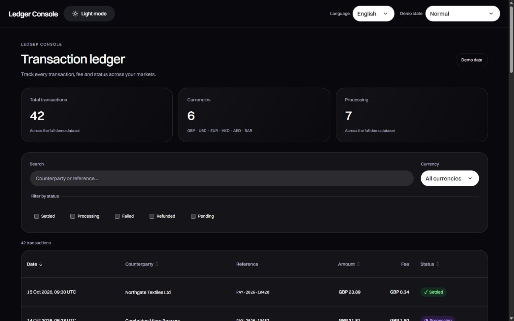

# Ledger Console

A personal financial-interface concept built with **React, TypeScript and reusable design-system components**. One ledger page makes amounts, fees, refunds and recovery states inspectable.



**Concept only:** all 42 transactions and counterparties are fictional. No payments, wallet connections or real authentication are performed. No client delivery, production adoption or business uplift is claimed.

## Try it

Download **[Ledger Console.html](Ledger%20Console.html)** and open it in a browser. The complete JavaScript and CSS are embedded; no server or installation is needed. Theme persistence depends on the browser's local-file storage policy.

The header switches dark/light mode, English/Arabic and the local error scenarios. Search or filter the ledger, open a row to inspect its timeline, and compare full or partial refund breakdowns.

## What is implemented

See the [role-aligned delivery index](docs/DELIVERABLES.md) for all seven requested artifacts, the [component guide](docs/COMPONENT_GUIDE.md) for usage rules and Figma references, and the [internationalization / accessibility guide](docs/I18N_ACCESSIBILITY.md) for the review matrix.

- Search, status/currency filters and sorting that groups currencies without implying FX conversion.
- Explicit ISO currency codes, integer minor-unit totals, decimal tie rounding and safe-value checks.
- Full/partial refunds with separate principal return, fee return, refund credit and remaining net debit.
- Loading, filtered-empty, network-error, permission-denied and expired-session states with local recovery.
- English/Arabic, RTL, bidirectional money isolation and visible UTC timestamps.
- Shared dark/light component contracts, 44px core controls and a keyboard-managed details drawer.
- A 78-token generator and Storybook component examples.
- Inspectable persistent loading, no-data and long-text scenarios in the header.
- Storybook form validation, disabled controls, blocked states and a shared theme toolbar.

## Run the source

Use Node.js 22.18+ (or Node.js 24) and npm. Install development dependencies yourself with `npm ci`, then:

```sh
npm run dev
npm run build
npm test
npm run storybook
npm run build-storybook
```

`npm run build` checks TypeScript, generates tokens, creates `dist/`, and exports both `Ledger Console.html` and `docs/index.html` as standalone builds. `Start Preview.bat` serves the built app; `Start Storybook.bat` starts the component catalogue when dependencies are installed.

## Design decisions and evidence

### Interactive article examples

`scripts/sync-portfolio.mjs` copies the current Storybook build and removes
obsolete generated JavaScript/CSS chunks from the portfolio's Storybook assets.
Rebuild Storybook before syncing changes to its components or stories.

Each of the five visible delivery sections has a runnable window: responsive components,
token overrides, the actual Storybook catalogue, boundary
states, and locale/RTL access. The four focused
React examples reuse production components from this repository; Storybook is the
fifth window. English/Chinese article preferences are sent to the examples
without resetting their interaction state. The locale example also supports Arabic.

The Design tokens section includes a visual design-system board. Its swatches,
values and copy actions read the ledger's active CSS variables, including theme
surfaces, Select colors and interaction states. The unused legacy palette stays
hidden; the displayed count reflects the current catalogue, not all 78 JSON entries.
The board also shows typography, spacing, radii, motion and layers. All 13 shared
components render directly from `src/components/`. The States section shows 18
button/input specimens plus a live validation and Select example. Its pinned
hover, pressed and focus states share CSS with native interactions, and the same
catalogue is available in Storybook under Components/Interaction states.
Catalogue typography uses the existing 22px page title, 18px section title,
14px group heading and 12px label/value tokens. The duplicate display title is
removed; typography specimens retain their actual source sizes and weights.
Use its section navigation or open
`projects/ledger-console/examples.html?example=system&lang=en` in the portfolio.

`npm run build` exports `docs/article-examples.html` after the main ledger build.
`npm run build-storybook` exports the actual catalogue. Rebuild article markup with
`npm run build:article-visuals`, then sync to the portfolio. The iframe windows load
only near the viewport and offer a separate-tab link. Tokens, forms, recovery,
checklists and downloads are local previews; nothing is submitted or published.

- [Case study](docs/CASE_STUDY.md)
- [Implementation handoff](docs/IMPLEMENTATION_HANDOFF.md)
- [Validation and limits](docs/VALIDATION.md)
- [Audit and remediation](docs/UI_AUDIT_EN.md)

The visual treatment adapts selected controls from a supplied Figma library: Button 22:25906 / 22:26058, Input 22:26741 and TableHeader 110:21982. The ledger composition, financial rules, accessibility behavior and light theme are concept-specific implementation decisions. This is a documented, source-inspired mapping, not a complete or automatically synchronized Figma system. Font rendering uses a local fallback when the source font is unavailable.

## Keep the portfolio article in sync

The article source is `docs/portfolio.json`. After editing it or rebuilding the demo, run:

```sh
node scripts/sync-portfolio.mjs --portfolio /path/to/portfolio_01
```

This updates the independent article module, the standalone demo and four selected screenshots. It does not rewrite other project articles. The existing portfolio shell registers the new entry once; subsequent updates only replace Ledger Console's own files.

## Financial boundaries

The six fixture currencies all use two decimals. Decimal midpoint values round away from zero before integer-unit addition. Currency grouping is not FX conversion. The refund policy retains original fees and is explicitly illustrative. Real financial records, permissions, refund policies and transaction execution belong to a production service and are outside this prototype.

Native-speaker review, comprehensive screen-reader testing and task-based usability research remain future validation work. No automatic Figma Code Connect, visual-regression coverage or complete WCAG certification is claimed.
